# STM32 NUCLEO-F446RE FreeRTOS Semaphore Button Interrupt

## Project Overview

This project shows the standard **ISR-to-task signaling pattern** of an RTOS, using **FreeRTOS** on the **STM32 NUCLEO-F446RE** board.

An external push button is connected to **D2 (PA10)** and works as an interrupt. When the button is pressed, the interrupt routine does only one small job: it gives a **binary semaphore**. A task named `ButtonTask` sleeps until that semaphore arrives, then wakes up, toggles an LED and prints the press count over UART. A second task, `HeartbeatTask`, keeps blinking another LED every 500 ms the whole time, which shows that the system is never blocked.

The project was created with **STM32CubeMX** and built, flashed and run with **STM32CubeIDE 2.2.0**. FreeRTOS is used through the **CMSIS-RTOS V2** interface.

## Key Features

- STM32 NUCLEO-F446RE board
- FreeRTOS with the CMSIS-RTOS V2 interface
- Two tasks running at the same time (`ButtonTask` and `HeartbeatTask`)
- External push button interrupt (EXTI) on PA10, falling edge, internal pull-up
- Binary semaphore given from the interrupt and taken by a task
- Task sleeps in the Blocked state until the button is pressed
- 200 ms software debounce
- Press count and time printed over UART (115200 baud) through the ST-LINK virtual COM port
- HAL timebase moved to TIM6, so SysTick is free for the RTOS
- Programming and debugging through the on-board ST-LINK

## Hardware Required

| Component                 | Quantity |
| ------------------------- | -------- |
| STM32 NUCLEO-F446RE board | 1        |
| Push button               | 1        |
| LED                       | 2        |
| 220 Ω resistor            | 2        |
| Breadboard                | 1        |
| Jumper wires              | As needed |
| USB cable (data cable)    | 1        |

## Pin Configuration

| Signal        | MCU Pin | Arduino Pin | Mode                                      |
| ------------- | ------- | ----------- | ----------------------------------------- |
| Toggle LED    | PA8     | D7          | GPIO_Output                               |
| Heartbeat LED | PA9     | D8          | GPIO_Output                               |
| Push button   | PA10    | D2          | GPIO_EXTI10, falling edge, internal pull-up |
| UART TX       | PA2     | -           | USART2_TX (ST-LINK virtual COM port)      |
| UART RX       | PA3     | -           | USART2_RX (ST-LINK virtual COM port)      |

## Wiring

| Component                          | Connection                |
| ---------------------------------- | ------------------------- |
| Toggle LED long leg (anode, +)     | D7 through a 220 Ω resistor |
| Toggle LED short leg (cathode, -)  | GND                       |
| Heartbeat LED long leg (anode, +)  | D8 through a 220 Ω resistor |
| Heartbeat LED short leg (cathode, -) | GND                     |
| Push button, leg 1                 | D2                        |
| Push button, leg 2 (opposite corner) | GND                     |

The button needs no external resistor, because the internal pull-up of PA10 is enabled in software. The pin reads HIGH normally and goes LOW when the button is pressed.

## Circuit Diagram

```
 NUCLEO-F446RE
┌───────────────┐
│  D7 (PA8)  ───┼──[220Ω]──► Toggle LED (+)    ┐
│               │                              │
│  D8 (PA9)  ───┼──[220Ω]──► Heartbeat LED (+) │
│               │                              │
│  D2 (PA10) ───┼──── Push button ─────────────┤
│               │                              │
│  GND ─────────┼──── GND rail ◄───────────────┴── both LED (-) legs and button leg 2
└───────────────┘
```

## Working Principle

The button interrupt only **signals**, and the task does the **real work**:

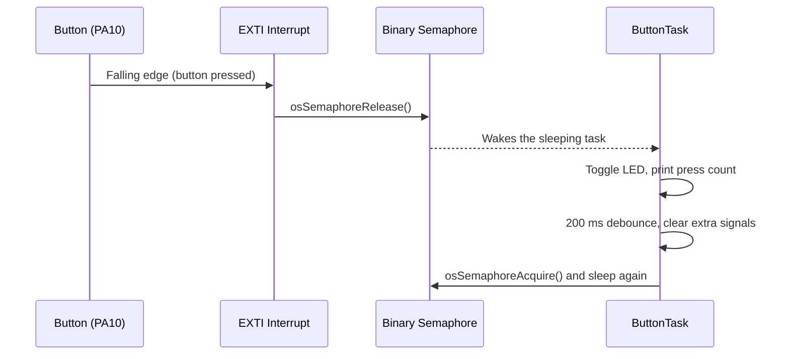

| Task            | Priority    | Stack  | Job                                            |
| --------------- | ----------- | ------ | ---------------------------------------------- |
| `ButtonTask`    | AboveNormal | 2048 B | Waits on the semaphore and handles every press |
| `HeartbeatTask` | Normal      | 512 B  | Toggles the heartbeat LED every 500 ms         |

## RTOS Concepts Used

| Concept                   | Where it appears in the code                                          |
| ------------------------- | --------------------------------------------------------------------- |
| Tasks                     | `StartButtonTask` and `StartHeartbeatTask`, created with `osThreadNew` |
| Scheduler                 | Started with `osKernelStart()`                                         |
| Priorities and preemption | `ButtonTask` runs as soon as the semaphore is given                    |
| Blocking                  | `osSemaphoreAcquire(..., osWaitForever)` and `osDelay()`               |
| ISR-to-task signaling     | `osSemaphoreRelease()` inside `HAL_GPIO_EXTI_Callback()`               |
| Binary semaphore          | `osSemaphoreNew(1, 0, NULL)` (maximum count 1, initial count 0)        |
| Interrupt priority rule   | EXTI interrupt priority 5, so it may call FreeRTOS functions           |
| Separate tick sources     | RTOS tick on SysTick, HAL tick on TIM6                                 |

## STM32CubeMX Configuration

### Pinout and Configuration

1. Create a new project and select the **NUCLEO-F446RE** board in the Board Selector.
2. Initialize all peripherals with their default mode.
3. Set **PA10** to `GPIO_EXTI10`.

[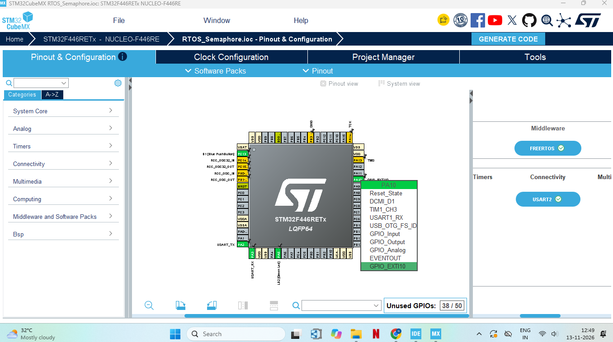](/NandhinidotS/STM32F446RE-FreeRTOS-Semaphore-Button-Interrupt/blob/main/MX_PinOut_PA10.png)

### GPIO Settings

Under **System Core → GPIO**, select **PA10** and set:

| Setting             | Value                                                      |
| ------------------- | ---------------------------------------------------------- |
| GPIO mode           | External Interrupt Mode with Falling edge trigger detection |
| GPIO Pull-up/Pull-down | Pull-up                                                 |

[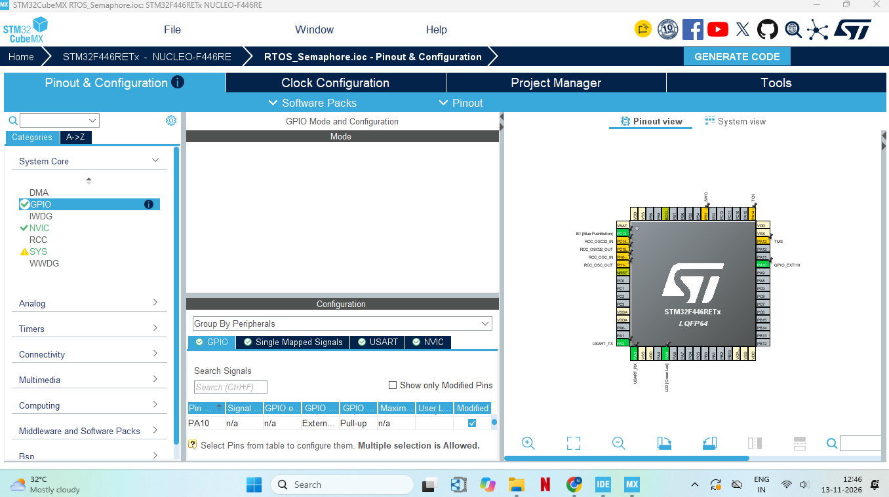](/NandhinidotS/STM32F446RE-FreeRTOS-Semaphore-Button-Interrupt/blob/main/MX_GPIO.png)

### NVIC Settings

Under **System Core → NVIC**, enable **EXTI line[15:10] interrupts** and set its preemption priority to **5**.

[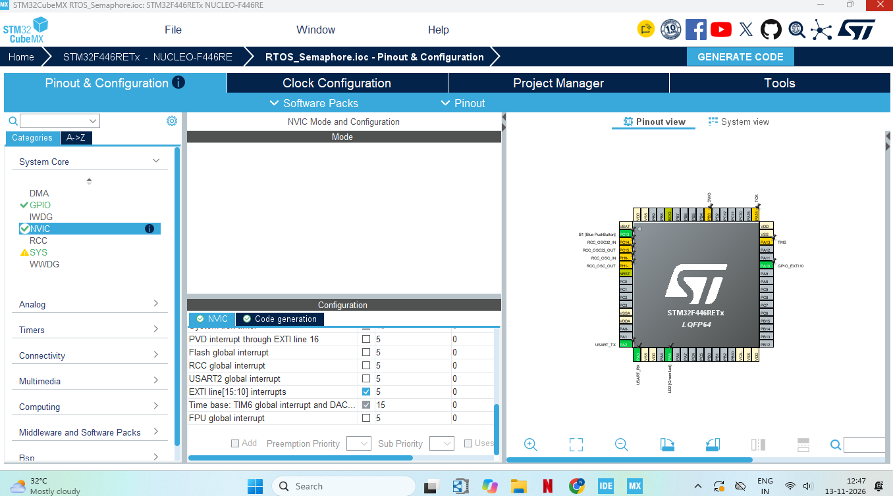](/NandhinidotS/STM32F446RE-FreeRTOS-Semaphore-Button-Interrupt/blob/main/MX_NVIC.png)

### SYS Timebase

Under **System Core → SYS**, set **Timebase Source** to **TIM6**. FreeRTOS uses SysTick for its own tick, so the HAL tick is moved to TIM6.

[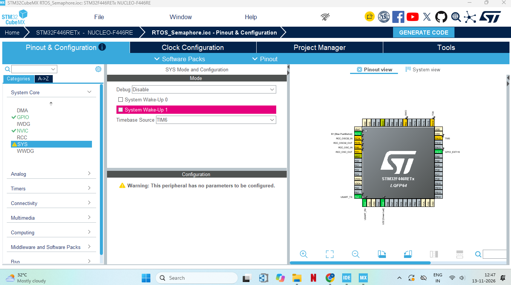](/NandhinidotS/STM32F446RE-FreeRTOS-Semaphore-Button-Interrupt/blob/main/MX_SYS.png)

### USART2

Under **Connectivity → USART2**, set the mode to **Asynchronous** with **115200** baud, 8 data bits, no parity and 1 stop bit.

[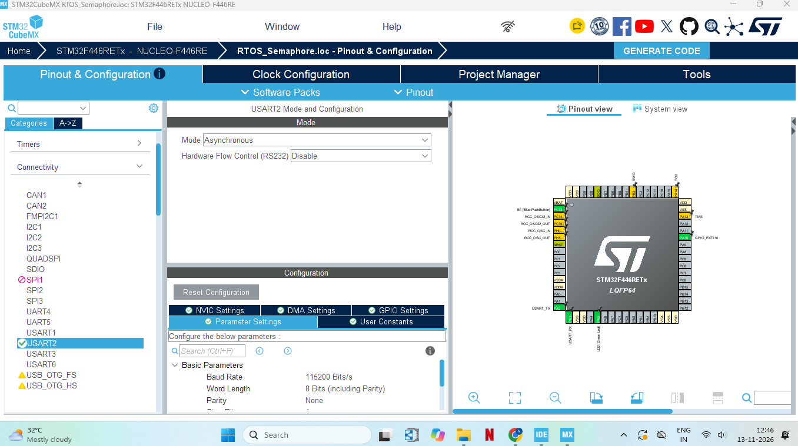](/NandhinidotS/STM32F446RE-FreeRTOS-Semaphore-Button-Interrupt/blob/main/MX_USART2.png)

### FreeRTOS

Under **Middleware and Software Packs → FREERTOS**, set the **Interface** to **CMSIS_V2**.

[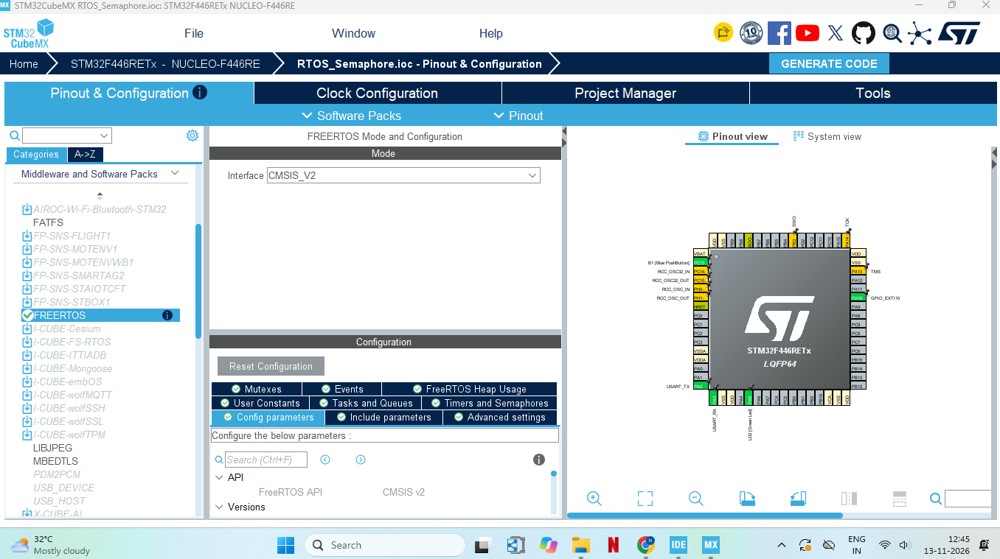](/NandhinidotS/STM32F446RE-FreeRTOS-Semaphore-Button-Interrupt/blob/main/MX_FreeRTOS.png)

### Project Manager and Folder Creation

A parent folder was created first, and CubeMX creates the project folder inside it:

```
C:\stm32_ws        ← parent folder (created manually)
└── RTOS_Semaphore ← created automatically by CubeMX
```

| Setting          | Value                                            |
| ---------------- | ------------------------------------------------ |
| Project Name     | RTOS_Semaphore                                   |
| Project Location | C:\stm32_ws (parent folder, chosen with Browse)  |
| Toolchain / IDE  | STM32CubeIDE                                     |
| Firmware Package | STM32Cube FW_F4 V1.28.3                          |

Then click **Generate Code** and **Open Project**.

[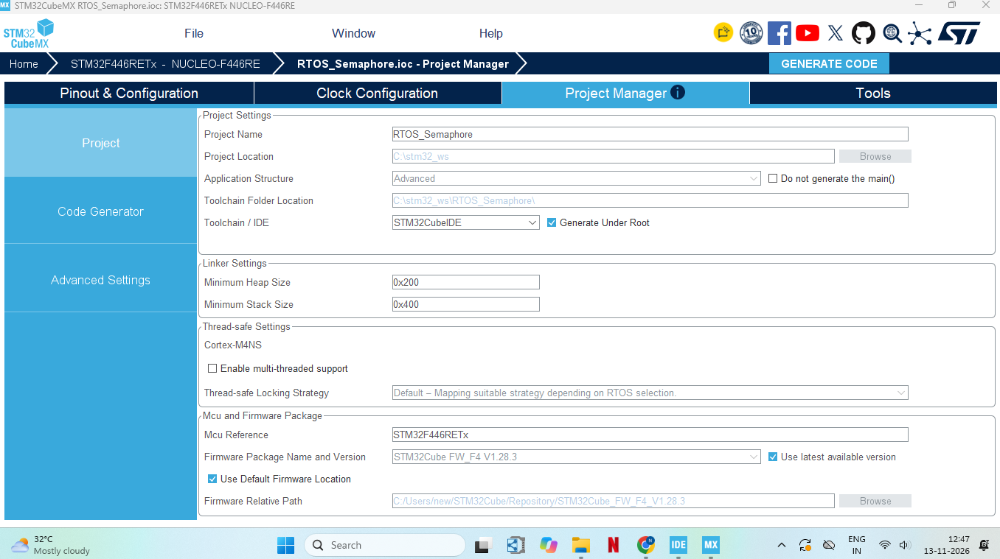](/NandhinidotS/STM32F446RE-FreeRTOS-Semaphore-Button-Interrupt/blob/main/MX_ProjectManager.png)

## Code

The complete application code is in `main.c` (it replaces `Core/Src/main.c` generated by CubeMX). The main parts are:

The semaphore is created before the tasks, with a maximum count of 1 and an initial count of 0:

```c
btnSem = osSemaphoreNew(1, 0, NULL);
```

The interrupt callback only gives the semaphore:

```c
void HAL_GPIO_EXTI_Callback(uint16_t GPIO_Pin)
{
  if (GPIO_Pin == GPIO_PIN_10)
  {
    osSemaphoreRelease(btnSem);
  }
}
```

`ButtonTask` sleeps until the semaphore is given, then handles the press and debounces:

```c
if (osSemaphoreAcquire(btnSem, osWaitForever) == osOK)
{
  pressCount++;
  HAL_GPIO_TogglePin(GPIOA, GPIO_PIN_8);
  /* print "[time ms] Button press #N" over USART2 */
  osDelay(200);
  while (osSemaphoreAcquire(btnSem, 0) == osOK) { }
}
```

`HeartbeatTask` runs independently:

```c
HAL_GPIO_TogglePin(GPIOA, GPIO_PIN_9);
osDelay(500);
```

## Working

At startup the kernel starts both tasks. The heartbeat LED begins blinking every 500 ms, and `ButtonTask` goes to sleep because the semaphore is empty.

When the button is pressed, PA10 goes LOW and the interrupt gives the semaphore. FreeRTOS wakes `ButtonTask` immediately, because it has the higher priority. The task toggles the LED, prints the press count over UART, waits 200 ms for the contact bounce to settle, clears any extra signals and sleeps again. The heartbeat LED keeps blinking during all of this.

```
Press → ISR gives semaphore → ButtonTask wakes → LED toggles + UART message → debounce → sleeps again
```

## Output

Each button press toggles the LED and prints a line in the terminal, while the heartbeat LED keeps blinking:

```
[62691 ms] Button press #8
[64110 ms] Button press #9
[66713 ms] Button press #10
[67102 ms] Button press #11
[67443 ms] Button press #12
[67794 ms] Button press #13
[68610 ms] Button press #14
```

[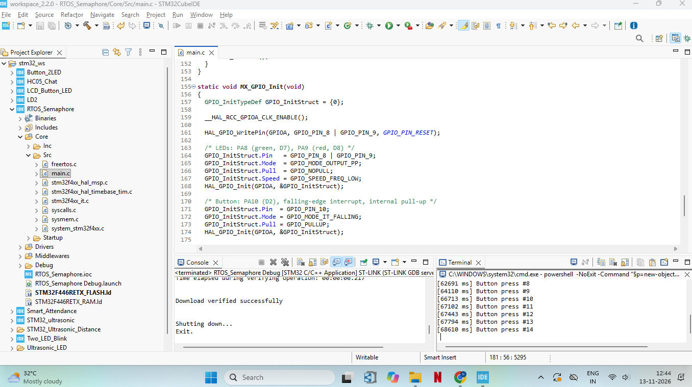](/NandhinidotS/STM32F446RE-FreeRTOS-Semaphore-Button-Interrupt/blob/main/IDE_Terminal.png)

*Press count printed in the STM32CubeIDE terminal.*

[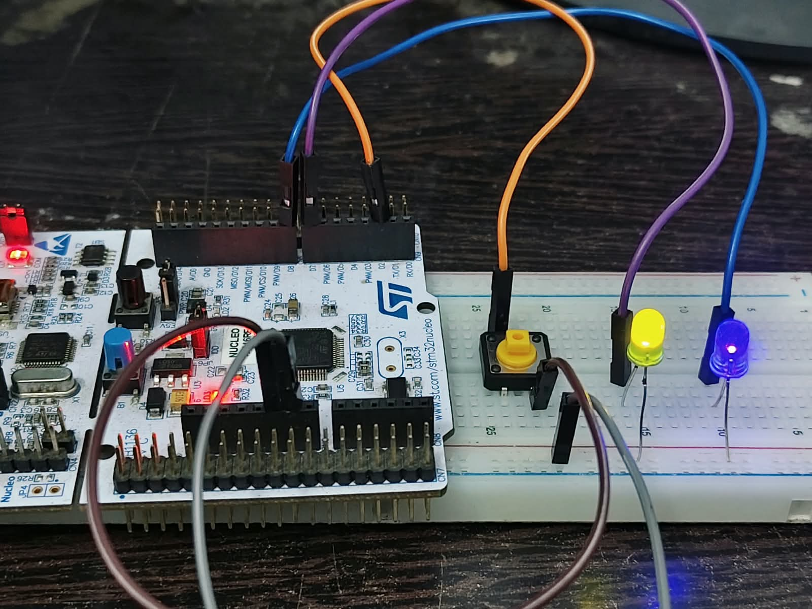](/NandhinidotS/STM32F446RE-FreeRTOS-Semaphore-Button-Interrupt/blob/main/Semaphore.jpeg)

*Hardware setup running the project.*

[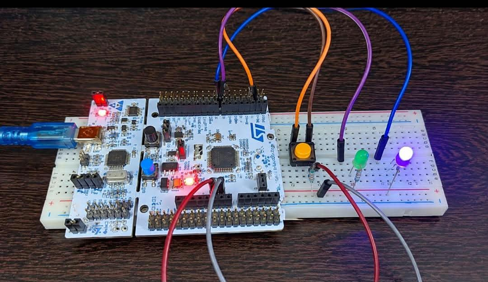](/NandhinidotS/STM32F446RE-FreeRTOS-Semaphore-Button-Interrupt/blob/main/Blue_led.jpeg)

*Another view of the hardware setup.*

## Demonstration Video

[▶️ Watch the FreeRTOS Semaphore Demonstration](https://drive.google.com/file/d/1tkdf7aMdBZXMfJ3AmlYh4H-RCceozLfv/view?usp=drivesdk)

## How to Run

1. Wire the LEDs and the push button as shown above.
2. Open **STM32CubeIDE**.
3. Go to `File → Import → General → Existing Projects into Workspace`.
4. Select the project folder and click **Finish**.
5. Build the project with the hammer icon.
6. Connect the board with a USB cable.
7. Click **Run** and accept the default debug configuration.
8. Open a terminal on the ST-LINK COM port at **115200 baud** and press the button.

## Testing

| Test                       | Result                                          |
| -------------------------- | ----------------------------------------------- |
| Build                      | Successful                                      |
| Flash through ST-LINK      | Successful                                      |
| Heartbeat LED              | Blinks every 500 ms                             |
| Button press               | Toggles the LED and prints the press count      |
| Heartbeat during a press   | Keeps blinking                                  |
| Debounce                   | One press is counted once                       |

## Important Notes

### Timebase Source

With FreeRTOS, the HAL timebase must not use SysTick. Set **SYS → Timebase Source** to **TIM6** in CubeMX, otherwise the RTOS and the HAL clash.

### Interrupt Priority

FreeRTOS only allows interrupts at priority **5 or numerically higher** to call its functions. The EXTI interrupt is set to 5, so it can safely call `osSemaphoreRelease()`.

### Button Wiring

The button is connected between **D2 (PA10)** and **GND**, using the internal pull-up. Use two legs on opposite corners of the push button, so the connection is made only when the button is pressed.

### Jumpers

Both **CN2** jumper caps on the board must be fitted. If they are missing, the debugger shows:

```
Error in initializing ST-LINK device.
Reason: No device found on target.
```

### Project Location

In the Project Manager, set the Project Location to the **parent folder** (for example `C:\stm32_ws`), not to a project folder. Otherwise CubeMX adds a second folder inside it and fails with "The system cannot find the path specified".

### Code Placement

In this project `main.c` is replaced completely with the application code. If the code is regenerated from CubeMX, `main.c` is overwritten, so keep a copy of it.

## Technologies and Concepts

- STM32 NUCLEO-F446RE
- STM32CubeIDE 2.2.0
- STM32CubeMX
- STM32 HAL library
- FreeRTOS (CMSIS-RTOS V2)
- Tasks and scheduler
- Binary semaphore
- External interrupt (EXTI)
- Switch debounce
- UART communication
- ST-LINK programming and debugging

## Future Improvements

- Counting semaphore to queue several quick presses
- Message queue between the button task and a logging task
- Mutex-protected UART shared by several tasks
- Software timer for long-press detection
